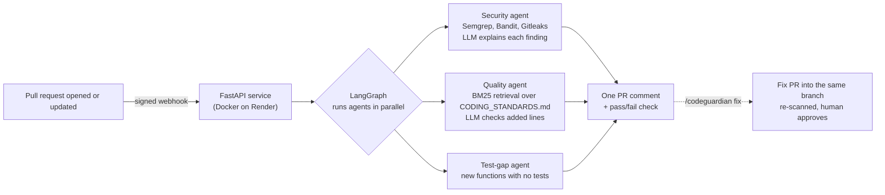

# CodeGuardian


An AI pull-request reviewer for GitHub. On every pull request, three agents check the changed code and post **one comment** plus a **pass/fail check**:

- **Security:** Semgrep, Bandit and Gitleaks find vulnerabilities and leaked secrets; an LLM explains each finding for the actual code and suggests a fix.
- **Coding standards:** the team's `CODING_STANDARDS.md` is searched for the rules relevant to the change (retrieval), and an LLM checks only the lines the PR adds against them.
- **Test gaps:** new public functions that no test mentions are listed.

Commenting **`/codeguardian fix`** opens a second pull request with fixes and drafted tests. Every fix is re-scanned before it is kept, and nothing is ever merged without a human.

Live service: `https://codeguardian-95w3.onrender.com/health`

## How it works



1. GitHub sends a signed webhook. The service verifies the HMAC signature, replies within GitHub's 10-second limit and reviews in the background.
2. It fetches only the PR's latest commit and only the files the PR changed.
3. LangGraph runs the three agents in parallel. If one fails, the others still report, and the comment says what didn't run.
4. One comment is posted and then edited on every push. The commit gets a **CodeGuardian** check that fails only on high-severity security issues.

## Safety design

The LLM is useful but untrusted, and so is the code in a pull request. Each rule below is enforced in code and covered by a test.

| Risk | What CodeGuardian does |
|---|---|
| LLM invents a vulnerability | Scanners decide what is a finding. The LLM only explains findings by ID; anything it adds is dropped. |
| LLM hides a real issue | "Likely false positive" is a label, never a deletion. |
| LLM cites a rule that doesn't exist | Quality findings are kept only for rules that were retrieved and lines the PR actually added. |
| Secrets sent to a third party | Secrets are redacted before any prompt. A file containing a secret is never sent for a fix. |
| PR rewrites the rules it's judged by | Coding standards are read from the target branch, not the PR. |
| PR adds a symlink to server files | Only regular files inside the checkout are read. |
| Prompt injection in PR code | Prompts say to ignore instructions in code, and outputs are validated against what was sent. |
| Bad automatic fix | A fix is kept only if it parses and the scanners find fewer issues. It goes to a separate PR that a human must merge. Drafted tests are never executed. |
| Token leaks into logs | Git errors that contain the authenticated URL are replaced with a clean message. |
| Forged webhooks | HMAC-SHA256 signature check with a constant-time comparison; no secret configured means everything is rejected. |
| Stale results | If a newer commit arrived during a review, the older review discards itself. |

## Results

Measured on the demo repository ([codeguardian_playground](https://github.com/SanyamJain-01/codeguardian_playground)):

| Measure | Result |
|---|---|
| Real vulnerabilities in the test PR found and explained | 2 of 2 (SQL injection, `shell=True`) |
| Coding-standard violations reported | 5, all correct, no invented rules |
| High-severity issues after `/codeguardian fix` | 2 to 0; the check went from failing to passing |
| Noise on test files after test-aware filtering | 10 findings to 3 (70% fewer), no real issue lost |
| Time from push to comment | under a minute |
| Automated tests | 21, run in GitHub Actions on every push |

## Tech stack

Python, FastAPI, LangGraph, rank-bm25, Semgrep, Bandit, Gitleaks, Groq (OpenAI-compatible API, `gpt-oss-120b`), GitHub REST API and webhooks, Docker, Render, GitHub Actions, pytest.

## Run it yourself

**Requirements:** Python 3.12, Docker, a GitHub fine-grained token and a Groq API key.

1. Create a `.env` file:
   ```
   WEBHOOK_SECRET=<random string, e.g. python -c "import secrets; print(secrets.token_hex(32))">
   GITHUB_TOKEN=<fine-grained token: Contents read/write, Pull requests read/write, Issues read/write, Commit statuses read/write>
   LLM_API_KEY=<Groq key>
   LLM_MODEL=openai/gpt-oss-120b
   ```
2. Build and run:
   ```bash
   docker build -t codeguardian .
   docker run --rm --env-file .env -p 8000:8000 codeguardian
   ```
3. In the repository to review, go to **Settings → Webhooks** and add `https://<your-host>/webhook` with content type `application/json`, the same secret and the events **Pull requests** and **Issue comments**. For local testing, forward with `npx smee-client`.
4. Optional: add your own `CODING_STANDARDS.md` to the repository's default branch, with one `## ID: title` section per rule.

**Tests:**

```bash
pip install -r requirements.txt
pipx install semgrep   # kept separate: its dependencies conflict with FastAPI's
pytest -q
```

## Limitations and next steps

- Background reviews are lost if the server restarts mid-review; a persistent job queue would fix this.
- Fixes rewrite whole files, so files over 20 KB are skipped; diff-based fixes would remove the limit.
- Keyword retrieval (BM25) fits the free tier's memory; embeddings would match rules by meaning.
- It runs as a webhook with a personal token; a GitHub App would let it install on any repository and post as a bot.
- Only same-repository branches get fix PRs, because a fork's branch can't be pushed to.
